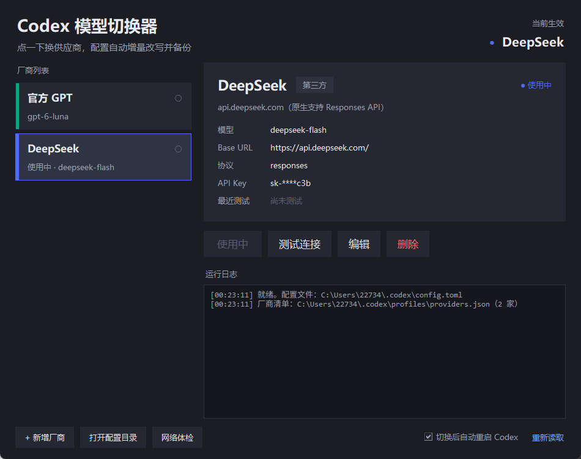

# Codex 模型切换器 v2

把 Codex 桌面版在**任意 OpenAI 兼容厂商**之间一键切换的小工具。双击运行，不碰配置文件。

> v1 只能「官方 GPT ↔ DeepSeek」二选一，v2 改成读一份 `providers.json` 清单：
> 清单里有几家就能切几家，而且可以在界面里自己**新增 / 编辑 / 删除**厂商。



---

## 一、它到底做了什么

Codex 只在启动时读一次 `~/.codex/config.toml`。所以「换供应商」的本质就是：

1. **增量改写** `~/.codex/config.toml` —— 只动 6 个顶层键和一段 `[model_providers.<id>]`，
   你后来自己加的 MCP server、字体、桌面设置、`notify` 数组**全都原样保留**
2. 为第三方厂商生成 `models.<id>.json`（Codex 靠它认识模型，否则模型列表里看不到）
3. 把改之前的配置备份到 `profiles\backup\`
4. 可选：自动关掉 Codex 再拉起来，让新配置立刻生效

它**不会**整文件覆盖模板 —— 这是 v1 最大的坑，v2 专门避开了。

---

## 二、安装

### 第 0 步：先把代码拿到本机

**方式 A · 下载 ZIP（不熟悉命令行的选这个）**

1. 打开仓库页面，点右上角绿色的 **`Code`** 按钮 → **`Download ZIP`**
2. 解压到任意目录，比如 `D:\Tools\codex-model-switcher`
   （解压出来可能叫 `codex-model-switcher-main`，名字无所谓，进去就行）
3. 进目录，**双击 `install.bat`**

**方式 B · git clone**

```bat
git clone https://github.com/babaozhou-ctrl/codex-model-switcher.git
cd codex-model-switcher
python install.py
```

> 如果提示找不到 `python`，Windows 上通常要用 `py -3 install.py`。
> `install.bat` 会自动在 `py` 和 `python` 之间挑能用的那个。

### 方式一：双击 `install.bat`（最简单）

脚本会：

- 找可用的 Python，把 `main.pyw` / `core.py` / `presets.json` / `README.md` 复制到 `%USERPROFILE%\.codex\profiles\`
- 在桌面创建「Codex 模型切换」快捷方式（指向 `pythonw.exe`，不弹黑框，图标用 Codex 自己的）
- **不会覆盖已存在的 `providers.json`**（那是你的配置，升级时要保住）

### 方式二：命令行

```bat
python install.py
```

常用参数：

```bat
python install.py --no-shortcut      :: 只部署，不建快捷方式
python install.py --shortcut-only    :: 只重建快捷方式（Codex 升级后图标丢了就用这个）
python install.py --target D:\test    :: 部署到别的目录（调试用）
```

### 方式三：完全手动

把 `main.pyw`、`core.py`、`presets.json` 一起丢进 `%USERPROFILE%\.codex\profiles\`，
然后双击 `main.pyw`（或给它建个快捷方式）。

### 环境要求

- Windows 10 / 11
- Python 3.8+（**只用标准库**，不需要 pip install 任何东西）
- 已安装并至少启动过一次 Codex 桌面版（需要 `~/.codex/config.toml` 存在，工具靠它做增量改写）

---

## 三、怎么用

1. 双击桌面图标 → 左边是厂商列表，右边是选中厂商的详情
2. 点某一家 → 右边「切换到此厂商」→ 配置改写 + 备份 +（可选）重启 Codex
3. 新增厂商：底部「+ 新增厂商」→ 在「从预设填充」里选一家（自动填好 Base URL 和模型名）
   → 贴上你的 API Key → 先点「测试连接」→ 通过后「保存」
4. 每家的状态小圆点：`✓` 绿 = 最近测试可用，`✗` 红 = 最近测试失败，`○` 灰 = 还没测过

### 界面上的改动都会立刻落盘

所有增删改都会写回 `%USERPROFILE%\.codex\profiles\providers.json`。
想手工编辑也行，改完点右下角「重新读取」。

### `providers.json` 结构

```json
{
  "version": 2,
  "active": "deepseek",
  "providers": [
    {
      "id": "openai",
      "name": "官方 GPT",
      "kind": "official",
      "desc": "ChatGPT 账号登录，用 auth.json 里的凭据",
      "model": "gpt-6-luna",
      "color": "#10a37f"
    },
    {
      "id": "deepseek",
      "name": "DeepSeek",
      "kind": "custom",
      "desc": "api.deepseek.com",
      "base_url": "https://api.deepseek.com/",
      "api_key": "sk-xxxx",
      "model": "deepseek-flash",
      "wire_api": "responses",
      "color": "#4d6bfe",
      "last_probe": {
        "at": "2026-10-21T23:00:00",
        "ok": true,
        "detail": "HTTP 200",
        "wire_api": "responses"
      }
    }
  ]
}
```

| 字段 | 说明 |
| --- | --- |
| `kind` | `official` = 官方 GPT，走 ChatGPT 账号登录，不写 `model_provider`；`custom` = 第三方，写 `model_provider` |
| `id` | 小写字母数字连字符，直接作为 `[model_providers.<id>]` 的键名。新增时由名称自动生成，冲突加 `-2` |
| `color` | 卡片左侧色条，新增时自动从调色板里取一个没用过的 |
| `api_key` | 明文存储（本机小工具，与厂商官方脚本的做法一致），**界面上只显示 `sk-****c3b` 掩码** |
| `last_probe` | 最近一次「测试连接」的结果，用来在列表上画 ✓ / ✗ |
| `wire_api` | 固定 `responses`（原因见第六节） |

---

## 四、内置预设

`presets.json` 里预置了常见厂商，新增时选一下就能自动填好地址和模型名。
**这些信息核对过官方文档，但厂商改地址、改模型名非常频繁，落地前请以各家控制台为准。**

| 厂商 | Base URL | 示例模型 | 备注 |
| --- | --- | --- | --- |
| 官方 GPT | （不需要） | `gpt-6-luna` | 走 ChatGPT 账号登录，用 `auth.json` |
| DeepSeek | `https://api.deepseek.com/` | `deepseek-flash` | **已原生支持 Responses API**，兼容性最好 |
| 阿里云百炼 / 通义千问 | `https://dashscope.aliyuncs.com/compatible-mode/v1/` | `qwen3-max` | 只提供 chat；新版控制台可能要带业务空间前缀 |
| 月之暗面 Kimi | `https://api.moonshot.cn/v1/` | `kimi-k2.6` | 只提供 chat；国际站是 `api.moonshot.ai` |
| 智谱 GLM | `https://open.bigmodel.cn/api/paas/v4/` | `glm-5.3` | 只提供 chat |
| 硅基流动 SiliconFlow | `https://api.siliconflow.cn/v1/` | `deepseek-ai/DeepSeek-V4-Pro` | 聚合平台，模型名必须带厂商前缀 |
| 火山方舟（豆包） | `https://ark.cn-beijing.volces.com/api/v3/` | `doubao-seed-2.1-pro` | 需先在控制台创建接入点，model 可能要填 `ep-xxx` |
| OpenRouter | `https://openrouter.ai/api/v1/` | `anthropic/claude-opus-4-6` | 聚合平台，模型名形如 `vendor/model` |

---

## 五、配置改写规则（给想知道细节的人）

假设当前 `config.toml` 是：

```toml
check_for_update_on_startup = false
notify = [ "...", "turn-ended" ]
model = "deepseek-flash"
model_provider = "deepseek"
model_reasoning_effort = "high"

[mcp_servers.node_repl]
...

[model_providers.deepseek]
...
```

切换到某个 **custom** 厂商后，只会有这些变化：

```toml
model = "<模型名>"
model_provider = "<id>"
preferred_auth_method = "apikey"
forced_login_method = "api"
web_search = "disabled"
model_catalog_json = "<profiles目录>/models.<id>.json"

[model_providers.<id>]
name = "<id>"
base_url = "<Base URL，保证以 / 结尾>"
wire_api = "responses"
experimental_bearer_token = "<API Key>"
```

- `preferred_auth_method` / `forced_login_method` / `web_search` / `model_catalog_json`
  会被先删掉再重写，所以反复切换不会堆出重复键
- `[model_providers.<id>]` 也是「先整段删掉再追加」，保证只出现一次
- 切到 **official** 时只写 `model = "..."`，其它 5 个键全部移除
- **其它厂商的段不会删**，这样能一键切回去
- 路径统一用正斜杠（Windows 反斜杠在 TOML 基本字符串里要转义，v1 踩过这个坑）

写盘之后会做一次静态自检，任何一项不过就**自动回滚到备份**并报错。自检内容：

| 检查 | 为什么 |
| --- | --- |
| 关键顶层键齐全、`model` 非空 | 少了 Codex 直接读不到模型 |
| provider id 只含字母数字下划线连字符 | 带空格/斜杠会让 TOML 解析报错；带**点号**更阴——TOML 合法但会变成嵌套表，`model_provider` 找不到段，配置静默失效 |
| `[model_providers.<id>]` 只出现一次 | 重复段在 TOML 里是非法重复定义 |
| `base_url` 是 `http(s)://` 开头且非空 | `ftp://` 或空串照样能写出去，但 Codex 一定发不出请求 |
| `wire_api` 必须是 `responses` | 0.163 遇到 `chat` 会拒绝加载整个配置 |
| 括号配平、引号闭合 | 兜底防手误 |

---

## 六、⚠️ 关于 `wire_api`，请务必读这一段

Codex CLI `0.163.0-alpha.11` **只支持 `wire_api = "responses"`**，
`wire_api = "chat"` 已经被官方移除（实测报错：`wire_api = "chat" is no longer supported`）。

而目前绝大多数国内厂商（百炼、Kimi、智谱、硅基流动、火山方舟、OpenRouter）
**只提供 OpenAI 兼容的 `/chat/completions`，没有实现 `/responses`**。

所以现实是：

- ✅ **DeepSeek** 自 2026-08 起原生支持 Responses API 并专门适配过 Codex，可以直接用
- ❌ 只有 chat 协议的厂商，**当前版本的 Codex 用不了**，这不是本工具能绕过的

**这正是「测试连接」按钮存在的原因**：它会真的往 `{base_url}responses` 发一次最小请求。

| 测试结果 | 含义 | 能不能用 |
| --- | --- | --- |
| `可用 — responses 可用` | 返回 200 | ✅ 可以切换 |
| `可用 — 端点存在（HTTP 400，参数差异）` | 端点存在，只是不认某个参数 | ✅ 基本可以用 |
| `警告 — 被限流，端点可用` | 返回 429 | ✅ 能用，注意配额 |
| `警告 — 该厂商只支持 chat 协议…` | `/responses` 404，但 `/chat/completions` 通 | ❌ **用不了** |
| `鉴权失败 — Key 无效或无权限` | 401 / 403 | ❌ 检查 Key |
| `失败 — 端点不存在，检查 Base URL` | 两个端点都 404 | ❌ 地址填错了 |

本工具**不会**为了让界面好看而谎报结果。测试说用不了就是用不了。

如果将来某家厂商支持了 `/responses`，你在界面上点一下「测试连接」就能立刻知道。

---

## 七、常见问题

**Q：窗口一片空白 / 起来就闪退？**
看 `%USERPROFILE%\.codex\profiles\last_error.log`，错误也会弹原生对话框提示。
`pythonw` 下没有控制台，所以所有异常都写这个文件。

**Q：切换后 Codex 里没变化？**
Codex 只在**启动时**读配置。取消勾选「切换后自动重启 Codex」的话，
需要你自己完全退出 Codex（不是最小化）再打开。

**Q：切换后 Codex 一直卡在 logo 转圈？**
先等一分钟。Codex 启动时会尝试建立远端会话（durable thread），如果 `auth.json` 里
的 ChatGPT 凭据已过期、而当前网络又连不上 `chatgpt.com`，它会在后台按 4s → 8s → 16s
退避重连，界面就一直停在 logo 上。**这段时间和模型供应商无关**——切到第三方 API 也
照样会卡，因为卡的是账号体系初始化，不是模型请求。

判断方法：看 `%LOCALAPPDATA%\Packages\OpenAI.Codex_2p2nqsd0c76g0\LocalCache\Local\Codex\Logs\`
下最新的日志，如果反复出现 `Sign in to ChatGPT to start a durable thread`，就是这种情况。
处理办法是让网络能通 `chatgpt.com`（刷新凭据），或者干脆等它退避完自己放弃、进主界面——
进去之后第三方模型照样能用。

**Q：切回官方 GPT 要重新登录吗？**
不用（前提是 token 没过期）。`auth.json` 两份配置共用，工具只读不写。

**Q：我的 MCP server 会不会丢？**
不会。v2 是增量改写，只动 6 个顶层键和一个 provider 段，其余原样保留。
切之前还会先备份，真出问题可以从 `profiles\backup\` 里捞回来。

**Q：怎么回滚？**
把 `profiles\backup\config-<原厂商>-<时间戳>.toml` 复制回 `~/.codex/config.toml` 即可。
时间戳精确到微秒，同一秒内连切多次也不会互相覆盖。

**Q：备份会一直堆下去吗？**
不会。为了不让一堆含明文 token 的文件无限堆积，只保留**最近 30 份**，
更早的会在下次备份时自动清掉。需要长期留存请自己另存一份。

**Q：`providers.json` 被我不小心改坏了怎么办？**
工具不会静默重置。启动时发现 JSON 解析不了，会把坏文件改名成
`providers.json.corrupt-<时间戳>` 留档，再生成一份默认清单，并弹窗告诉你备份路径。
手工改回来即可恢复。

**Q：API Key 存在哪？安全吗？**
明文存在 `providers.json` 里，和各家厂商官方脚本的做法一致。
这是本机工具，不上传任何数据。界面和日志里显示的永远是 `sk-****c3b` 这种掩码。

**Q：Codex 升级后桌面图标变成白纸？**
WindowsApps 下的路径带版本号，升级后会失效。重跑 `python install.py --shortcut-only`。

**Q：网络体检里 `api.openai.com` 显示 403？**
403 是「链路通但节点被拦」，说明代理通了但当前节点被 OpenAI 挡了，换个节点即可。

**Q：为什么列表里的模型名和我配的不一样？**
`models.<id>.json` 里的 `slug` 取自你填的模型名，`display_name` 会拼成
`厂商名 · 模型名`。如果 Codex 里还是看不到，检查 `model_catalog_json` 指向的文件是否存在。

---

## 八、目录结构

```
codex-model-switcher/
├── main.pyw          # 入口 + 全部 GUI（tkinter）
├── core.py           # 纯逻辑，无 UI 依赖，可 import 单测
├── install.py        # 部署到 ~/.codex/profiles 并建桌面快捷方式
├── install.bat       # Windows 一键安装（双击运行，自动挑 py / python）
├── presets.json      # 内置厂商预设（只读模板）
├── README.md         # 本文
├── docs/
│   └── screenshot.png
├── .gitignore
└── tests/
    └── test_core.py  # 96 个用例，纯标准库，不联网
```

跑测试：

```bat
python -m unittest discover -s tests -v
```

---

## 九、已知限制

1. 只在 Windows 上跑（依赖 `tasklist` / `taskkill` / `explorer.exe` / COM 建快捷方式）
2. 不校验 Codex 的实际版本号，如果官方将来改了配置字段名，需要跟着改 `core.DROP_TOP_KEYS`
3. 编辑厂商时**改名不会改 `id`**，因为 `id` 是 `config.toml` 里的键名。想让 id 一起变，
   请删掉重建（注意旧段不会被自动清理）
4. 探测只做「最小请求能否打通」，不代表该厂商的所有能力（工具调用、图片输入、
   推理强度）在 Codex 里都正常工作 —— 这些取决于厂商自己实现到什么程度
5. **`wire_api` 没有界面入口，固定写 `responses`**。因为 Codex 0.163 只支持这一种，
   给个下拉框等于让用户选一个必然失败的选项。如果 `providers.json` 被手工改成
   `"chat"`，保存厂商时会被自动纠正，切换时也会先自愈并往日志写一行说明。
6. 切换到不合法的厂商配置（id 有空格、Base URL 写错、协议不对）会**在校验阶段被拒**，
   此时不会产生备份、不会写 `models.*.json`、也不会动 `config.toml` —— 磁盘上零痕迹。
